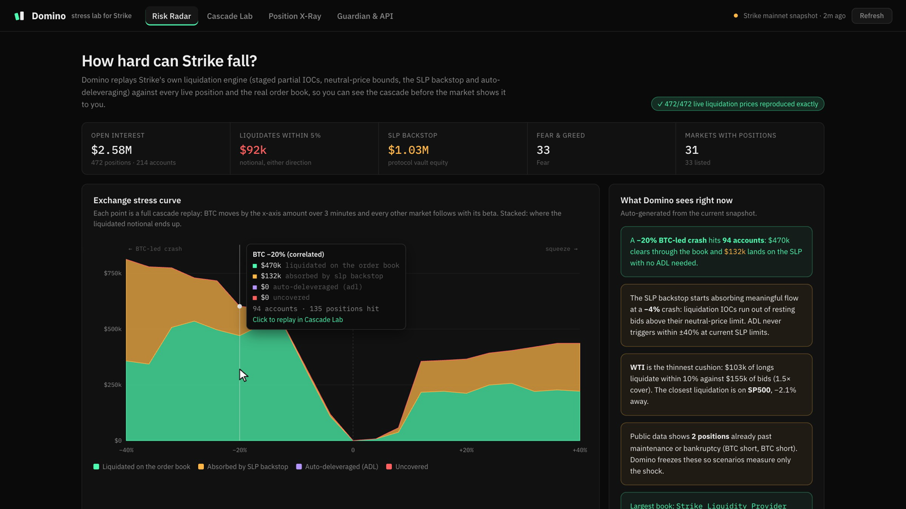
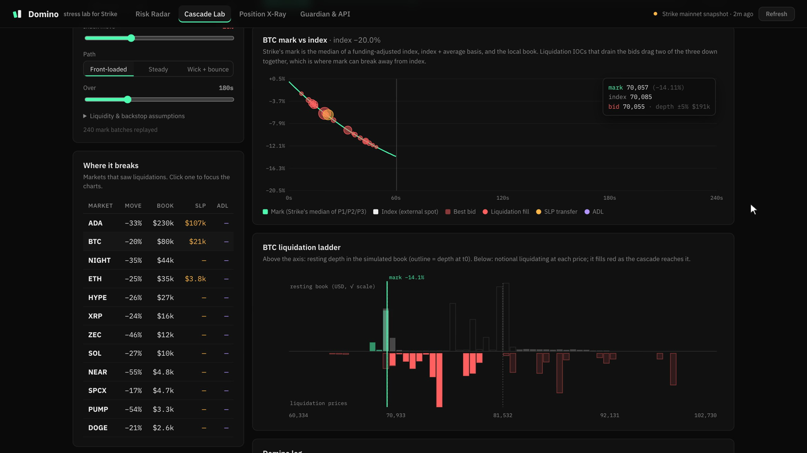
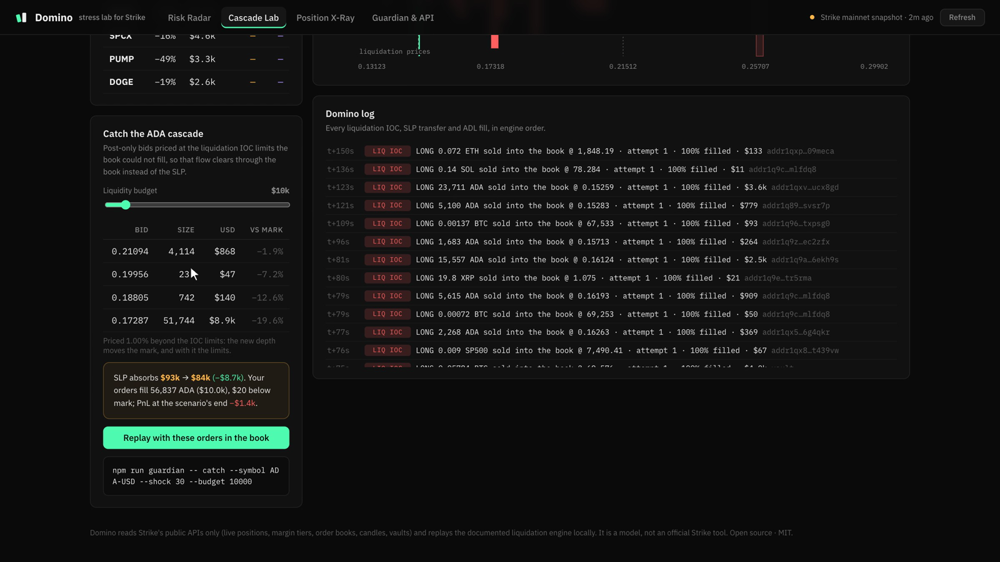
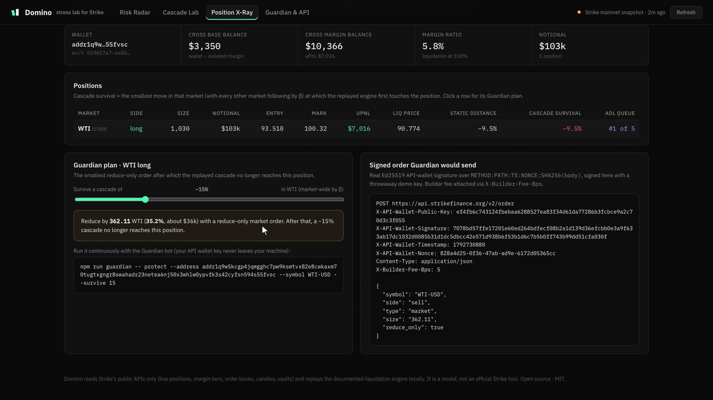

# Domino

**See the cascade before the market does.**

Domino is a liquidation-cascade lab for [Strike Finance](https://strikefinance.org) perps. It ports Strike's own liquidation engine to TypeScript, checks itself against every live liquidation price Strike serves (**472 of 472, exactly**), and then replays crashes second by second against every live position and the real order books.

One engine, three ways to use it:

- **Dashboard** (`apps/web`): Risk Radar, Cascade Lab, Catch and Position X-Ray. A static site with no backend that reads the public Strike API straight from the browser.
- **Guardian** (`apps/guardian`): a CLI bot. It keeps a wallet alive through a chosen cascade with signed reduce-only orders from your Strike API wallet, with a builder fee attached. It can also rest post-only bids where a cascade will run out of book.
- **MCP server** (`apps/mcp`): six read-only tools, so Claude or any other MCP agent can stress-test Strike before it trades.



## Why

On a perp exchange, liquidations aren't independent. A forced IOC sells into the book, the bids thin out, the mark slips, and the next position falls. Strike's engine is careful about this:

- staged partial IOCs, bounded by a neutral price
- the SLP vault as a backstop
- auto-deleveraging (ADL) as the last resort

None of that is visible ahead of time to traders, LPs or integrators. Domino makes it visible using only public data, and turns it into actions: cut this much, rest bids here, or ask an agent.

## What's inside

### Risk Radar

Twenty full cascade replays draw the exchange's stress curve. BTC leads from −40% to +40%, and every other market follows with its β, estimated from Strike's own hourly candles. For each move the curve shows:

- how much clears through the order book
- how much the SLP absorbs
- whether ADL triggers
- how much stays uncovered

On a mainnet snapshot, a 20% BTC-led crash hits 94 accounts. $470k clears through the book and $132k lands on the SLP, with no ADL. Below the curve, every market gets a row with its next long and short liquidation, the bids within 10%, and the cover ratio.

### Cascade Lab



Click any point on the curve to replay that crash one mark-price batch (one second) at a time. The Lab shows:

- mark vs. index, with every liquidation fill, SLP transfer and ADL fill plotted
- a liquidation ladder: resting depth above the axis, liquidating notional below it, turning red as the cascade reaches it
- a "where it breaks" table per market
- a log of every IOC attempt, SLP transfer and ADL fill, in engine order

Shocks can hit one market or move the whole market by β. The path can be front-loaded, steady, or a wick with a bounce. The liquidity and backstop assumptions are tunable.

### Catch



Domino finds the liquidation IOC limits the book could not fill, and prices post-only bids right there. These limits are endogenous: added depth moves the mark, and the mark moves the limits. So the planner replays candidate cushions and keeps the one that takes the most flow off the SLP.

Example: with a $10k budget in a 30% ADA crash, SLP absorption drops from $93k to $84k. About $8.7k of liquidations move back onto the book.

"Replay with these orders in the book" reruns the cascade with the bids resting. Each fill is attributed to a liquidation or to arbitrage.

### Position X-Ray



Paste any wallet, account or vault. For each position, X-Ray shows:

- the liquidation price
- the static distance to it
- **cascade survival**: the smallest market move at which the replayed cascade first reaches the position (often well before the static distance)
- the position's rank in the ADL queue
- Guardian's plan: the smallest reduce-only order after which the chosen cascade no longer reaches the position, with the real signed request

### Guardian (CLI bot)

```bash
# exchange-wide stress curve, market risk and closest liquidations
npm run guardian -- scan

# keep every position of a wallet out of reach of a 15% cascade, re-checking every 30 s
npm run guardian -- protect --address addr1q… --survive 15 --watch 30 --builder-fee 5

# actually send the reduce-only orders (needs a Strike API wallet)
STRIKE_API_PUBLIC_KEY=… STRIKE_API_PRIVATE_KEY=… \
npm run guardian -- protect --address addr1q… --survive 15 --watch 30 --live

# rest post-only bids where a 30% ADA crash's liquidation IOCs run out of book
npm run guardian -- catch --symbol ADA-USD --shock 30 --budget 10000
```

- **Dry run by default.** Orders are built, Ed25519-signed and printed. Only `--live` sends them.
- Keys come from the environment and never leave your machine.
- `--builder-fee <bps>` attaches `X-Builder-Fee-Bps`, so integrators earn on the flow Guardian creates.
- `--max-order <usd>` refuses any single order above that notional (default $25k).
- `--network testnet` uses Strike's testnet API.
- `--fixture fixtures/snapshot.json` makes runs reproducible.
- `--shock 30` is a 30% crash; `--shock +30` is a 30% squeeze.

### MCP server

```bash
# Claude Code
claude mcp add domino -- npx tsx /path/to/domino/apps/mcp/src/server.ts
```

```json
{
  "mcpServers": {
    "domino": { "command": "npx", "args": ["tsx", "/path/to/domino/apps/mcp/src/server.ts"] }
  }
}
```

| Tool | What it answers |
| --- | --- |
| `market_risk` | Open interest, nearby liquidations, bid depth and cover per market |
| `stress_test` | "What does a 15% BTC-led crash do to Strike?" Book / SLP / ADL / uncovered split, accounts hit, per-market breakdown, largest events |
| `position_xray` | A wallet's positions, liquidation prices, cascade survival, ADL rank |
| `liquidation_ladder` | Liquidating notional per price bucket next to resting bid/ask depth |
| `derisk_plan` | The smallest reduce-only order that survives an N% cascade |
| `catch_plan` | Post-only bids that move a cascade's flow off the SLP and onto the book |

All tools are read-only and work on live data, cached for 60 s. Set `STRIKE_NETWORK=testnet` to use testnet. `npm run smoke:mcp` calls every tool against mainnet.

## Built on the Strike API

Everything comes from Strike's public endpoints. There is no backend, scraping or private data.

| Endpoint | Used for |
| --- | --- |
| `GET /v2/markets` | Margin tiers, tick and step sizes, market status |
| `GET /stat/v1/stats/live-positions` | Every open position: balances, entries, sizes, and the liquidation prices Strike serves (used for validation) |
| `GET /price/v2/depth` | Order books, up to 1,000 levels per side |
| `GET /price/v2/klines` | 7 days of hourly candles, for each market's β to the leader |
| `GET /price/v2/marketStats` | Market categories (crypto, commodity, equity, index) |
| `GET /v2/vaults` | SLP equity (the backstop's size) and the largest vault books |
| `GET /price/v2/fearGreed` | The Fear & Greed reading on the Radar |
| `GET /v2/fee-tiers` | Taker fees, which set the IOC limit prices |
| `POST /v2/order` | Guardian's orders: Ed25519 API-wallet signature over `METHOD:PATH:TS:NONCE:SHA256(body)`, with `X-Builder-Fee-Bps` |

## Why trust the numbers

The first thing Domino does with a snapshot is recompute every liquidation price from public data alone:

```
LP = (entry − (W + TU − TM + MA) / size) / (1 − D · MMR)
```

On the bundled mainnet snapshot it reproduces **472 / 472** served liquidation prices. The worst relative error is 1.1 × 10⁻¹³. The dashboard shows this check live, against live data.

`npm test` runs 19 tests. They encode Strike's documented worked examples, including:

- a 1 BTC position at 125% margin ratio liquidating 0.5 BTC in its first IOC
- impact-price and P1 funding examples
- mark falling back to P2 beyond the 5% index deviation
- maintenance-amount continuity across margin tiers

They also check invariants:

- size is conserved across book, SLP and ADL
- deeper crashes never liquidate less
- a resting order the market never reaches changes nothing
- catch orders never overfill

## How the engine models Strike

- **Mark price** is `median(P1, P2, P3)`, recomputed in one-second batches:
  - P1: funding-adjusted index
  - P2: index plus average basis
  - P3: impact price on the local book
- **Margin** uses tiered maintenance rates with maintenance-amount continuity, for both cross and isolated accounts.
- **Liquidation** follows Strike's staged process:
  - up to five IOC attempts, sized from 20% to 100% of the position by margin ratio
  - each IOC's limit is the neutral price adjusted for the taker fee and tick-aligned away from the trader, so a liquidation is never worse for the trader than its neutral price
  - whatever the book can't fill goes to the SLP backstop
  - when the SLP declines, the profitable opposite side is auto-deleveraged, ranked by profit % × effective leverage
- **The book**:
  - Levels within 2% of mid are market-maker quotes. They re-peg to the index, get pulled as the move deepens, and refill over time.
  - Deeper levels are static, and arbitrage takes them once the index passes them.

A few things are assumptions, and each can be tuned in the Lab:

- Strike does not publish the SLP's acceptance rule (its drawdown and per-market exposure caps), so Domino models one.
- Every account pays tier-0 taker fees.
- Positions already past maintenance in a snapshot are frozen, so scenarios measure only the shock.

## Run it

Requires Node 22+.

```bash
npm install
npm run dev          # dashboard on http://localhost:5173 (live mainnet data)
npm test             # engine tests
npm run typecheck    # engine, web, guardian, mcp
npm run snapshot     # refresh fixtures/snapshot.json from mainnet
```

Add `?fixture` to the dashboard URL to use the bundled snapshot instead of live data. The dashboard also falls back to it automatically if Strike is unreachable. `npm run build` produces a static site in `apps/web/dist` that any static host can serve.

To use the engine directly, in Node or the browser:

```ts
import { loadSnapshot, correlatedScenario, simulate } from "@domino/engine";

const snap = await loadSnapshot();               // live Strike mainnet
const crash = correlatedScenario(snap, -0.2);    // BTC −20%, every other market by β
const { totals, events } = simulate(snap, crash);
```

## The demo video is code too

`video/` builds the demo video end to end:

- **Footage**: [Playwright](https://playwright.dev) drives the real app frame by frame under a fake clock, so every capture is deterministic.
- **Motion graphics**: [Remotion](https://remotion.dev).
- **Narration**: Deepgram Aura-2. Deepgram speech-to-text then checks the pronunciation and provides word timings, so animations land on the spoken word.
- **Sound**: the effects and the music bed are synthesized from scratch.

```bash
cd video && npm install
npm run facts            # numbers from the engine on the bundled snapshot
npm run tts              # narration (needs DEEPGRAM_API_KEY in ../.env)
npm run words            # word timings from Deepgram speech-to-text
npm run guardian-output  # real Guardian CLI output for the terminal scene
npm run sfx              # synthesized sound effects and music bed
npm run capture          # deterministic footage of the running app (DOMINO_URL, default http://localhost:5180/)
npm run render           # out/domino.mp4
npm run master           # loudness-normalised out/domino-final.mp4
```

## Layout

```
packages/engine   TypeScript port of Strike's mark price, margin and liquidation engine; simulator; analysis; API-wallet signing
apps/web          Dashboard (Vite + React): Risk Radar, Cascade Lab, Catch, Position X-Ray, Guardian & API
apps/guardian     CLI bot: scan, protect, catch
apps/mcp          MCP server (stdio)
fixtures          A mainnet snapshot for tests, offline demos and reproducible runs
video             The demo video (Remotion + Playwright + Deepgram)
```

## Disclaimer

Domino is a model built on Strike's public documentation and APIs. It is not an official Strike Finance tool and not financial advice. Guardian sends real orders only when you pass `--live` with your own API wallet keys.

## License

MIT
